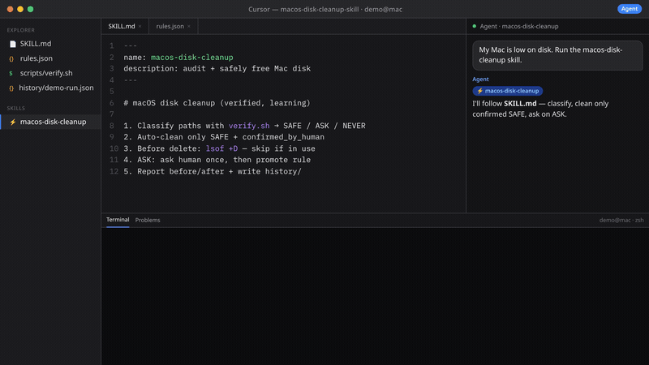

# macOS Disk Cleanup Skill for AI Agents (Claude Code, Cursor)

[](LICENSE)
[](https://agentskills.io)
[](https://code.claude.com/docs/en/skills)
[](https://cursor.com)
[](#what-it-does)

**macos-disk-cleanup-skill is an AI-agent skill that frees disk space on your Mac safely: it only auto-deletes what you've approved once, and learns from every confirmation.**

It is for Mac users and developers who want Claude Code, Cursor, or any agent that can read a `SKILL.md` and run shell commands to handle mac disk cleanup and macOS storage cleanup (caches, package-manager stores, Xcode DerivedData, logs) without risking personal files.

> **In one sentence:** a human-in-the-loop Mac cleaner for AI coding agents that classifies every path as SAFE, ASK, or NEVER and only deletes SAFE paths a human has confirmed.



*Agent-facing demo on fake data (`demo@mac`): agent reads `SKILL.md` → audit SAFE/ASK/NEVER → clean only human-confirmed SAFE (lsof skips in-use) → ASK asks and promotes the rule → before/after + `history/` log. [MP4](https://resume-box.tail6a877d.ts.net/macos-disk-cleanup/macos-disk-cleanup-demo.mp4) · [Funnel](https://resume-box.tail6a877d.ts.net/macos-disk-cleanup/)*

## What it does
- Audits the usual space hogs: `~/Library/Caches`, package-manager caches (npm, pnpm, yarn, pip, uv, Go, Cargo, Homebrew), app updater (ShipIt) caches, Xcode DerivedData, logs, Downloads, Movies, Docker, iOS backups and runaway log files.
- Classifies every path as **SAFE**, **ASK** or **NEVER** with `scripts/verify.sh` against an ordered rule file (first match wins).
- Cleans with official commands where they exist (`brew cleanup -s`, `pnpm store prune`, `uv cache clean`, `go clean -modcache`, `npm cache clean --force`).
- Reports free space before and after, space freed per item, what it skipped and why.
- Investigates the root cause when space vanishes again (re-downloading updaters, crash-looping services writing logs) and writes down how to undo any service it disables.

## Install
```bash
git clone https://github.com/liush2yuxjtu/macos-disk-cleanup-skill.git
cd macos-disk-cleanup-skill
cp rules.example.json rules.json      # your local, learned rules (git-ignored)
```
- **Claude Code:** copy or symlink the folder into `~/.claude/skills/macos-disk-cleanup/` (or `.claude/skills/` in a project).
- **Cursor:** put it in `.cursor/skills/macos-disk-cleanup/` (or reference `SKILL.md` from a rule / `AGENTS.md`).
- **Other agents:** point the agent at `SKILL.md`.

## Usage
Ask your agent: *"My Mac is low on disk space, run the macos-disk-cleanup skill."*

Check a path yourself:
```bash
scripts/verify.sh ~/Library/Caches/Homebrew/downloads
# SAFE ~/Library/Caches/Homebrew/** confirmed=false
```
Optional: run it from a daily routine that only acts when free space drops below a threshold (e.g. 10 GB).

## How human-confirmation learning works
1. Every rule in `rules.json` has `class` and `confirmed_by_human`. The example file ships with **every rule unconfirmed**.
2. The agent auto-deletes a path only if its rule is `SAFE` **and** `confirmed_by_human: true`.
3. Anything else is listed with size and modification time, and you're asked once.
4. When you approve a regenerable class (e.g. "Homebrew cache is fine to clear"), the agent flips `confirmed_by_human` to `true` and stamps `confirmed_at`. Next time it cleans that class without asking.
5. Personal folders (Downloads, Movies) stay `ASK` forever and are confirmed every time. `NEVER` paths are never touched.
6. Each run is recorded in `history/<run>.json` so the agent can compare runs and spot what grew.

## Safety guarantees
- Unknown paths default to **ASK**, never to delete.
- Before any delete: path exists and matches the rule, `lsof +D` / `pgrep` show it isn't in use (locks are never forced), and rule conditions (`older_than_hours`, `keep_newest`, `only_if_app_not_running`) hold.
- Growing logs are truncated (`: > file`), not deleted.
- Irreversible artifacts (e.g. recordings) are offered for cloud backup first and deleted only after the upload is verified.
- Never touches Documents, Desktop, Photos, Mail, Messages, keychains or app databases; never restarts the machine or kills unapproved processes.
- Account-recovery files and personal documents are always kept and asked about.
- Your learned `rules.json` and `history/` are git-ignored, so nothing personal ends up in your fork.

## FAQ
**What is macos-disk-cleanup-skill?**
An agent skill (a `SKILL.md` plus helper scripts) that lets an AI agent such as Claude Code or Cursor audit and clean disk space on macOS using an ordered SAFE / ASK / NEVER rule file.

**Is it safe to let an AI agent clean my Mac?**
The skill only auto-deletes paths whose rule is `SAFE` and `confirmed_by_human: true`. Unknown paths default to ASK, in-use files are skipped, logs are truncated rather than deleted, and Documents, Desktop, Photos, Mail, Messages, keychains and app databases are never touched.

**What does it clean on macOS?**
`~/Library/Caches`, npm/pnpm/yarn/pip/uv/Go/Cargo/Homebrew caches, ShipIt updater caches, Xcode DerivedData, logs, Docker, iOS backups, and (always with confirmation) Downloads and Movies.

**Which agents does it work with?**
Claude Code, Cursor, and any agent that can read a `SKILL.md` and run shell commands.

**How does it learn?**
When you approve a regenerable class once, the agent sets `confirmed_by_human: true` in your local `rules.json`, so it cleans that class without asking next time.

## 中文简介
**macOS 磁盘清理 AI 代理技能（适用于 Claude Code、Cursor）：让 AI 代理安全地清理 Mac 磁盘：只自动删除你确认过一次的内容，并从每次确认中学习。**

- 按 `rules.json` 将路径分为 SAFE（可清理）/ ASK（每次询问）/ NEVER（绝不触碰）。
- 只有 SAFE 且经人工确认过的规则才会自动清理；未知路径默认询问。
- 删除前检查文件是否被占用，优先使用官方清理命令，日志采用截断而非删除。
- 安装：复制 `rules.example.json` 为 `rules.json`，把目录放入 Claude Code 或 Cursor 的 skills 目录，然后让代理"运行 macos-disk-cleanup"。

## License
MIT
